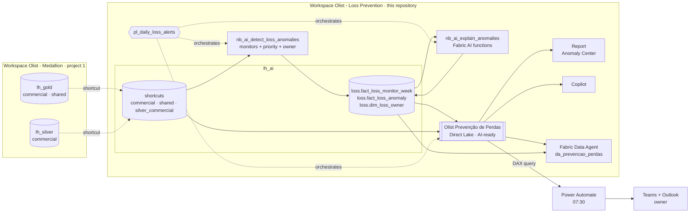
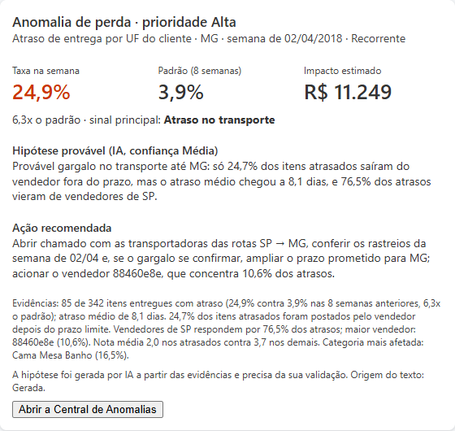
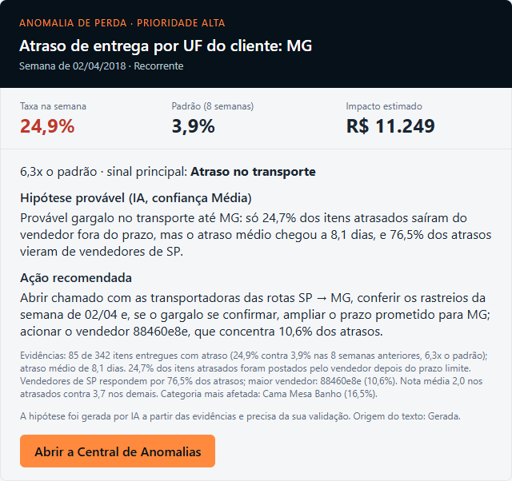

# AI-ready semantic model, agent and loss alerts on Microsoft Fabric

[🇧🇷 Português](README.md) · 🇺🇸 English

A dashboard shows a loss after it happened. This project closes **Case 01 of the *Beyond the Dashboard* series** with what comes next: **detect** the week a loss rate broke its pattern, **prioritize** it by BRL impact, **alert** the right owner in Teams and **guide the action** with an AI-generated root-cause hypothesis. All on top of an **AI-ready semantic model** that Copilot and a **Fabric Data Agent** use to answer questions about losses.

It builds on the [Medallion Lakehouse on Fabric](https://github.com/danielresende23/fabric-lakehouse-medallion) project (public Olist dataset): its Gold layer comes in through shortcuts, with no copy.

> Business names in the model, report, alerts and notebooks are in Portuguese (the model has an en-US translation). This page translates the documentation.

---

## Problem

In e-commerce, loss means canceled or unavailable orders and late deliveries, which drag the customer review score down (from ~4.3 to ~2.3 on Olist). The project 1 dashboard says *how much* was lost in a period. It does not say:

1. **Which week, in which segment, broke the pattern** and how much it cost above normal.
2. **Why it probably happened:** a seller shipping late, the carrier, cancellations or stock-outs.
3. **Who has to act and what to do**, before month-end close.
4. **How to ask** all of that in natural language without opening a report.

## Solution

| Step | What it does | Where |
|---|---|---|
| **Detect** | 3 weekly monitors (lost revenue by category, late delivery by customer state, late delivery by seller) with a robust per-segment baseline | [`nb_ai_detect_loss_anomalies`](fabric/nb_ai_detect_loss_anomalies.Notebook/notebook-content.py) |
| **Prioritize** | BRL impact above baseline, High / Medium / Low priority, owner by monitor and region | same notebook, versioned configuration |
| **Explain** | Root-cause hypothesis, recommended action and confidence with **Fabric AI functions**, grounded in computed evidence, with a rule-based fallback text | [`nb_ai_explain_anomalies`](fabric/nb_ai_explain_anomalies.Notebook/notebook-content.py) |
| **Alert** | Power Automate reads pending anomalies from the model and sends a Teams card and an email to the owner | [`automation/power-automate`](automation/power-automate) |
| **Ask** | AI-ready model (descriptions, synonyms, AI instructions, verified answers) + a Fabric Data Agent created and tested as code | [`ai/`](ai), [`nb_ai_setup_data_agent`](fabric/nb_ai_setup_data_agent.Notebook/notebook-content.py), [`nb_ai_evaluate_data_agent`](fabric/nb_ai_evaluate_data_agent.Notebook/notebook-content.py) |

## Architecture



| Item | Role |
|---|---|
| `lh_ai` | Project 1 Gold and Silver through schema shortcuts ([ADR 0002](docs/decisions/0002-camada-ia-por-shortcuts.md)); outputs in the `loss` schema |
| `pl_daily_loss_alerts` | Detect → Explain with AI → model rebind and framing; `as_of_date` parameter to replay history |
| `Olist Prevenção de Perdas` | Project 1 model + **Loss Anomalies** table (7 measures and 23 visible columns, all described), Direct Lake on OneLake |
| `da_prevencao_perdas` | Data Agent with two sources: the model (KPIs, anomaly counts and impact) and `lh_ai` (evidence, baseline, owners) |
| "Loss anomaly alert" flow | Power Automate: queries the model, adaptive card in Teams and email |

## Detection: what counts as an anomaly

Baseline = **median of the segment's own previous 8 weeks**, excluding weeks that were already anomalies. Robust score (MAD) ≥ 3.5, rate above a multiple of the baseline, minimum volume and minimum impact, all at once. The rule fits in one sentence, and that sentence is what the owner receives ([ADR 0001](docs/decisions/0001-deteccao-robusta-explicavel.md), [method and limitations](docs/anomaly-detection.md)).

**Replay over the Olist history:** 30 anomalies in two years (10 high priority), BRL 148K of estimated impact above baseline. Rio de Janeiro accounts for 43% in two waves of late deliveries:


The second wave (Mar 2018) only shows up because the baseline ignores anomalous weeks; in the first version of the rule it went unnoticed. The fix is recorded in the ADR.

## AI as automation, with guardrails

The LLM **does not decide** what is an anomaly or who gets it ([ADR 0003](docs/decisions/0003-ia-generativa-explica-nao-decide.md)). It only receives computed facts and returns validated JSON:

- **Rule-based main signal**, e.g. *Seller shipped after the deadline* when 50% or more of the late items left after the shipping limit. It anchors the hypothesis.
- **Evidence** as text: rate vs. baseline, average delay, concentration by seller, state and category, review score.
- **Validated output** (JSON, fields, length, confidence). Invalid output or AI unavailable: rule-based text, `Hypothesis Status = Regra`, and the alert still goes out.
- `temperature = 0`, prompt version and model stored per row; the owner always reads "likely hypothesis, to be validated".

## Alert to the owner

Each new anomaly of the last complete week with High or Medium priority becomes a Teams card and an email to the owning team (Category management, Logistics for the customer's region, or Seller success). The "what to alert" rule lives in the data, not in the flow ([ADR 0004](docs/decisions/0004-alerta-power-automate-sobre-o-modelo.md)).

| Teams card | Email |
|---|---|
|  |  |

Figures for the Minas Gerais anomaly in the week of 2018-04-02 come from the replay; the hypothesis and action are an example in the format the notebook returns.

## AI-ready semantic model

The model is the prompt: Copilot and the Data Agent write DAX from its metadata.

- **TMDL** with a description on every table, visible column and measure, with meaning, unit and exclusions in the first 200 characters (what Copilot reads); hidden keys, `summarizeBy: none`, `sortByColumn`, marked date table, `discourageImplicitMeasures`, Q&A on and en-US translation.
- **Loss Anomalies table** related only to the calendar, with the rule for reading the Segment column written in its description and in the instructions.
- **Prep data for AI kit** in [`ai/`](ai): [AI instructions](ai/ai-instructions.md) (glossary, defaults, limits), [AI data schema](ai/ai-data-schema.md) with measure dependencies, [synonyms](ai/synonyms.md), [7 verified answers](ai/verified-answers.md) and [25 test questions](ai/test-questions.md) with expected answers.
- Validated by loading the TMDL folder into the tabular engine (Power BI Modeling MCP): 10 tables, 14 relationships, measures and the en-US culture with no errors.

## Data Agent as code

`nb_ai_setup_data_agent` creates and publishes the agent with the **Fabric Data Agent SDK**: instructions, sources, tables and 7 example SQL queries in Git. Business rules stay in the model, because on a semantic model source the agent writes DAX only from the model metadata and Prep data for AI. `nb_ai_evaluate_data_agent` runs 12 questions with expected answers and fails below 80% accuracy ([ADR 0005](docs/decisions/0005-agente-como-codigo.md)).

## Demo script (10 minutes)

1. **The problem** (1 min). Report, *Perdas no E-commerce* page: BRL 108K lost and 6.8% late deliveries. "The dashboard says how much. It does not say which week, why, or who acts."
2. **Detection** (2 min). Run `pl_daily_loss_alerts` with `as_of_date = 2018-04-09`. Open `nb_ai_detect_loss_anomalies`: 3 anomalies in the week of 2018-04-02 (MG, Seller 88460e8e, Seller 620c87c1). Show the RJ chart and the one-sentence rule.
3. **Explanation** (2 min). In `nb_ai_explain_anomalies`, the output for MG: main signal *Late in transit* (only 24.7% of late items shipped after the deadline) versus Seller 88460e8e, with 100% shipped late. Show the rule-based fallback.
4. **Alert** (2 min). Run the flow with `DestinatarioTeste` = your email: MG (High) arrives for Logistics Southeast and Seller 88460e8e (Medium) for Seller success. Seller 620c87c1 (Low) stays on the dashboard.
5. **Anomaly Center** (1 min). Report page: weekly queue with hypothesis, action and owner.
6. **Ask** (2 min). In the Data Agent: "Por que MG entrou em anomalia de atraso na semana de 02/04/2018?" and "Como estava o atraso em MG nas semanas antes?". In Copilot: "quais anomalias temos" (verified answer). Close with "what is the margin of these categories?": the agent says the model has no margin.
7. Run again with `as_of_date = 2018-09-03` to load the full history, then `nb_ai_evaluate_data_agent`.

## Repository layout

```
fabric/                                    # folder connected to Fabric Git integration
├── lh_ai.Lakehouse/
├── nb_ai_utils.Notebook/                  # OneLake paths, item events, run log
├── nb_ai_setup_shortcuts.Notebook/        # schema shortcuts to project 1
├── nb_ai_detect_loss_anomalies.Notebook/  # monitors, baseline, evidence, priority, owner
├── nb_ai_explain_anomalies.Notebook/      # Fabric AI functions + validation + rule-based text
├── nb_ai_refresh_semantic_model.Notebook/ # rebind and framing
├── nb_ai_setup_data_agent.Notebook/       # Data Agent as code
├── nb_ai_evaluate_data_agent.Notebook/    # agent regression test
├── pl_daily_loss_alerts.DataPipeline/
├── Olist Prevenção de Perdas.SemanticModel/
├── Olist Prevenção de Perdas.Report/      # loss overview + Anomaly Center
└── Olist Prevenção de Perdas.pbip
ai/                                        # Prep data for AI: instructions, schema, synonyms, verified answers, tests
automation/power-automate/                 # flow, DAX query, adaptive card, email
docs/
├── decisions/                             # ADRs 0001 to 0005
├── anomaly-detection.md
└── img/
```

## How to reproduce

**Prerequisites:** the [Medallion Lakehouse](https://github.com/danielresende23/fabric-lakehouse-medallion) project loaded in a workspace; a **paid F2 or higher capacity** (AI functions and Data Agent do not run on trial; without them, detection, rule-based text, report and alert still work); Power Automate with Teams and Outlook.

1. **Fork** this repository.
2. Create the `Olist - Prevenção de Perdas [DEV]` workspace on the same capacity and connect it under *Workspace settings → Git integration* to the `/fabric` folder of `main`.
3. Run `nb_ai_setup_shortcuts` with `source_workspace` = the project 1 workspace name.
4. Run `pl_daily_loss_alerts` with `as_of_date = 2018-04-09` (demo) or empty (production).
5. Apply the [`ai/`](ai) kit in the model's *Prep data for AI* and mark it **Approved for Copilot** after testing.
6. Run `nb_ai_setup_data_agent` and, with the full history (`as_of_date = 2018-09-03`), `nb_ai_evaluate_data_agent`.
7. Build the flow following [`automation/power-automate/README.md`](automation/power-automate/README.md).

The TMDL ships sample IDs in the `OneLake_AI` expression; the last pipeline step rebinds the model to the workspace's `lh_ai`.

## Images

The detection charts and alerts were generated from the real Olist data (local replay of the rule). Screenshots of Fabric running (pipeline, Anomaly Center, Data Agent, Copilot and the alert received in Teams) are listed in [`docs/img/README.md`](docs/img/README.md) and will be added after the first run on a paid capacity.

## Stack

Microsoft Fabric (Lakehouse, OneLake shortcuts, PySpark notebooks, Data Pipeline, Direct Lake, **Fabric AI functions**, **Fabric Data Agent + SDK**) · Power BI (PBIP, TMDL, PBIR, DAX, **Copilot, Prep data for AI**) · Power Automate (Power BI, Teams, Outlook) · Semantic Link · GitHub.

## License and data

Code under [MIT](LICENSE). The data is **not** in this repository: the *Brazilian E-Commerce Public Dataset by Olist* is distributed on Kaggle under [CC BY-NC-SA 4.0](https://creativecommons.org/licenses/by-nc-sa/4.0/), with attribution to Olist. Owner emails use the fictitious `contoso.com` domain.

---

**Daniel Resende** · Analytics Engineer · [Portfolio](https://danielresende23.github.io/Portfolio) · [LinkedIn](https://www.linkedin.com/in/daniel-resend/)
