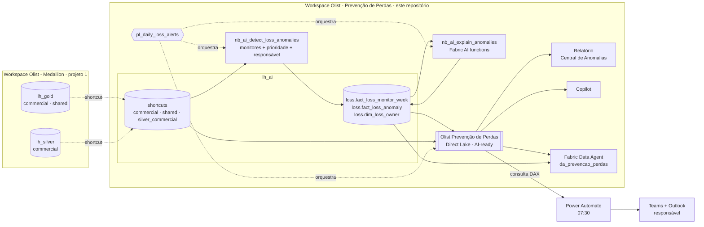

# Modelo semântico AI-ready, agente e alerta de perdas no Microsoft Fabric

🇧🇷 Português · [🇺🇸 English](README.en.md)

Um dashboard mostra a perda depois que ela aconteceu. Este projeto fecha o **Caso 01 da série *Além do Dashboard*** com o que vem depois: **detectar** a semana em que a perda saiu do padrão, **priorizar** pelo impacto em R$, **alertar** o responsável certo no Teams e **orientar a ação** com uma hipótese de causa gerada por IA. Em cima de um **modelo semântico preparado para IA**, que o Copilot e um **Fabric Data Agent** usam para responder perguntas sobre as perdas.

Continua o projeto [Lakehouse Medallion no Fabric](https://github.com/danielresende23/fabric-lakehouse-medallion) (dataset público Olist): a Gold dele entra aqui por shortcuts, sem cópia.

---

## Problema

No e-commerce, perda é venda cancelada ou indisponível e entrega atrasada, que derruba a nota do cliente (de ~4,3 para ~2,3 no Olist). O painel do projeto 1 diz *quanto* se perdeu no período. Ele não diz:

1. **Qual semana, de qual segmento, saiu do normal** e quanto isso custou acima do padrão.
2. **Por que provavelmente aconteceu:** vendedor que postou fora do prazo, transporte, cancelamento ou ruptura.
3. **Quem precisa agir e o que fazer**, antes do fechamento do mês.
4. **Como perguntar** isso em linguagem natural sem abrir relatório.

## Solução

| Etapa | O que faz | Onde |
|---|---|---|
| **Detectar** | 3 monitores semanais (venda perdida por categoria, atraso por UF do cliente, atraso por vendedor) com linha de base robusta por segmento | [`nb_ai_detect_loss_anomalies`](fabric/nb_ai_detect_loss_anomalies.Notebook/notebook-content.py) |
| **Priorizar** | Impacto estimado em R$ acima do padrão, prioridade Alta / Média / Baixa, responsável por monitor e região | mesmo notebook, configuração versionada |
| **Explicar** | Hipótese de causa, ação recomendada e confiança com **Fabric AI functions**, ancoradas em evidências calculadas e com texto por regra se a IA falhar | [`nb_ai_explain_anomalies`](fabric/nb_ai_explain_anomalies.Notebook/notebook-content.py) |
| **Alertar** | Power Automate lê as anomalias pendentes no modelo e manda card no Teams e e-mail ao responsável | [`automation/power-automate`](automation/power-automate) |
| **Perguntar** | Modelo AI-ready (descrições, sinônimos, AI instructions, verified answers) + Fabric Data Agent criado e testado por código | [`ai/`](ai), [`nb_ai_setup_data_agent`](fabric/nb_ai_setup_data_agent.Notebook/notebook-content.py), [`nb_ai_evaluate_data_agent`](fabric/nb_ai_evaluate_data_agent.Notebook/notebook-content.py) |

## Arquitetura



| Item | Papel |
|---|---|
| `lh_ai` | Gold e Silver do projeto 1 por schema shortcuts ([ADR 0002](docs/decisions/0002-camada-ia-por-shortcuts.md)); saídas no schema `loss` |
| `pl_daily_loss_alerts` | Detectar → Explicar com IA → rebind e framing do modelo; parâmetro `as_of_date` para replay do histórico |
| `Olist Prevenção de Perdas` | Modelo do projeto 1 + tabela **Anomalias de Perda** (7 medidas e 23 colunas visíveis, todas descritas), Direct Lake on OneLake |
| `da_prevencao_perdas` | Data Agent com duas fontes: modelo (KPIs, contagem e impacto) e `lh_ai` (evidências, linha de base, responsáveis) |
| Fluxo "Alerta de anomalia de perda" | Power Automate: consulta o modelo, card adaptativo no Teams e e-mail |

## Detecção: o que entra como anomalia

Linha de base = **mediana das 8 semanas anteriores do próprio segmento**, sem as semanas que já foram anomalia. Escore robusto (MAD) ≥ 3,5, taxa acima de um múltiplo do padrão, volume e impacto mínimos, tudo ao mesmo tempo. A regra é explicável em uma frase, e é essa frase que o gestor recebe ([ADR 0001](docs/decisions/0001-deteccao-robusta-explicavel.md), [método e limitações](docs/anomaly-detection.md)).

**Replay sobre o histórico do Olist:** 30 anomalias em dois anos (10 de prioridade Alta), R$ 148 mil de impacto estimado acima do padrão. O RJ concentra 43% em duas ondas de atraso:


A segunda onda (mar/2018) só aparece porque a linha de base ignora as semanas anômalas; na primeira versão da regra ela passava em branco. A correção está registrada na ADR.

## IA como automação, com guardrails

O LLM **não decide** o que é anomalia nem quem recebe ([ADR 0003](docs/decisions/0003-ia-generativa-explica-nao-decide.md)). Ele recebe só fatos já calculados e devolve JSON validado:

- **Sinal principal por regra**, ex.: *Postagem do vendedor fora do prazo* quando 50% ou mais dos itens atrasados saíram depois do prazo limite. Ancora a hipótese.
- **Evidências** em texto: taxa x padrão, atraso médio, concentração por vendedor, UF e categoria, nota da avaliação.
- **Saída validada** (JSON, campos, tamanho, confiança). Inválida ou IA indisponível: texto por regra, `Status da Hipótese = Regra`, e o alerta sai do mesmo jeito.
- `temperature = 0`, versão do prompt e modelo gravados por linha; o gestor sempre lê "hipótese provável, a validar".

## Alerta ao responsável

Cada anomalia nova da última semana completa, de prioridade Alta ou Média, vira um card no Teams e um e-mail para a área dona (Comercial, Logística da região do cliente ou Gestão de Sellers). A regra de "o que alertar" está no dado, não no fluxo ([ADR 0004](docs/decisions/0004-alerta-power-automate-sobre-o-modelo.md)).

| Card no Teams | E-mail |
|---|---|
|  |  |

Números da anomalia de MG na semana de 02/04/2018, calculados no replay; hipótese e ação são um exemplo no formato devolvido pelo notebook.

## Modelo semântico AI-ready

O modelo é o prompt: Copilot e Data Agent montam DAX a partir dos metadados.

- **TMDL** com descrição em toda tabela, coluna visível e medida, com significado, unidade e exclusões nos primeiros 200 caracteres (o que o Copilot lê); chaves ocultas, `summarizeBy: none`, `sortByColumn`, calendário marcado, `discourageImplicitMeasures`, Q&A ligado e tradução en-US.
- **Tabela Anomalias de Perda** relacionada só ao Calendário, com a regra de leitura do Segmento escrita na descrição e nas instruções.
- **Kit Prep data for AI** em [`ai/`](ai): [AI instructions](ai/ai-instructions.md) (glossário, padrões, limites), [AI data schema](ai/ai-data-schema.md) com dependências das medidas, [sinônimos](ai/synonyms.md), [7 verified answers](ai/verified-answers.md) e [25 perguntas de teste](ai/test-questions.md) com resposta esperada.
- Validado carregando a pasta TMDL no motor tabular (Power BI Modeling MCP): 10 tabelas, 14 relacionamentos, medidas e cultura en-US sem erro.

## Data Agent como código

O `nb_ai_setup_data_agent` cria e publica o agente pelo **Fabric Data Agent SDK**: instruções, fontes, tabelas e 7 exemplos de SQL no Git. Regras de negócio ficam no modelo, porque na fonte semântica o agente gera DAX só com os metadados e o Prep data for AI. O `nb_ai_evaluate_data_agent` roda 12 perguntas com resposta esperada e falha abaixo de 80% de acerto ([ADR 0005](docs/decisions/0005-agente-como-codigo.md)).

## Roteiro de demonstração (10 minutos)

1. **O problema** (1 min). Relatório, página *Perdas no E-commerce*: R$ 108 mil perdidos e 6,8% de atraso no período. "O painel diz quanto. Não diz qual semana, por quê, nem quem age."
2. **Detecção** (2 min). Rodar `pl_daily_loss_alerts` com `as_of_date = 2018-04-09`. Abrir `nb_ai_detect_loss_anomalies`: 3 anomalias na semana de 02/04/2018 (MG, Vendedor 88460e8e, Vendedor 620c87c1). Mostrar o gráfico do RJ e a regra em uma frase.
3. **Explicação** (2 min). No `nb_ai_explain_anomalies`, a saída para MG: sinal principal *Atraso no transporte* (só 24,7% dos itens atrasados postados fora do prazo) contra o Vendedor 88460e8e, com 100% postado fora do prazo. Mostrar o fallback por regra.
4. **Alerta** (2 min). Rodar o fluxo com `DestinatarioTeste` = seu e-mail: chegam MG (Alta) para a Logística Sudeste e Vendedor 88460e8e (Média) para Gestão de Sellers. O Vendedor 620c87c1 (Baixa) fica no painel.
5. **Central de Anomalias** (1 min). Página do relatório: fila por semana com hipótese, ação e responsável.
6. **Perguntar** (2 min). No Data Agent: "Por que MG entrou em anomalia de atraso na semana de 02/04/2018?" e "Como estava o atraso em MG nas semanas antes?". No Copilot: "quais anomalias temos" (verified answer). Fechar com "qual a margem dessas categorias?": o agente diz que o modelo não tem margem.
7. Rodar de novo com `as_of_date = 2018-09-03` para carregar o histórico completo e o `nb_ai_evaluate_data_agent`.

## Estrutura do repositório

```
fabric/                                    # pasta conectada à Git integration do Fabric
├── lh_ai.Lakehouse/
├── nb_ai_utils.Notebook/                  # caminhos OneLake, eventos por item, run log
├── nb_ai_setup_shortcuts.Notebook/        # schema shortcuts para o projeto 1
├── nb_ai_detect_loss_anomalies.Notebook/  # monitores, linha de base, evidências, prioridade, responsável
├── nb_ai_explain_anomalies.Notebook/      # Fabric AI functions + validação + texto por regra
├── nb_ai_refresh_semantic_model.Notebook/ # rebind e framing
├── nb_ai_setup_data_agent.Notebook/       # Data Agent como código
├── nb_ai_evaluate_data_agent.Notebook/    # teste de regressão do agente
├── pl_daily_loss_alerts.DataPipeline/
├── Olist Prevenção de Perdas.SemanticModel/
├── Olist Prevenção de Perdas.Report/      # Perdas no E-commerce + Central de Anomalias
└── Olist Prevenção de Perdas.pbip
ai/                                        # Prep data for AI: instruções, schema, sinônimos, verified answers, testes
automation/power-automate/                 # fluxo, consulta DAX, card adaptativo, e-mail
docs/
├── decisions/                             # ADRs 0001 a 0005
├── anomaly-detection.md
└── img/
```

## Como reproduzir

**Pré-requisitos:** o projeto [Lakehouse Medallion](https://github.com/danielresende23/fabric-lakehouse-medallion) carregado num workspace; capacidade **F2 ou superior paga** (AI functions e Data Agent não rodam em trial; sem elas, detecção, texto por regra, relatório e alerta funcionam); Power Automate com Teams e Outlook.

1. **Fork** deste repositório.
2. Crie o workspace `Olist - Prevenção de Perdas [DEV]` na mesma capacidade e conecte em *Workspace settings → Git integration* à pasta `/fabric` da `main`.
3. Rode o `nb_ai_setup_shortcuts` com `source_workspace` = nome do workspace do projeto 1.
4. Rode o `pl_daily_loss_alerts` com `as_of_date = 2018-04-09` (demonstração) ou vazio (produção).
5. Aplique o kit de [`ai/`](ai) em *Prep data for AI* no modelo e marque **Approved for Copilot** depois dos testes.
6. Rode o `nb_ai_setup_data_agent` e, com o histórico completo (`as_of_date = 2018-09-03`), o `nb_ai_evaluate_data_agent`.
7. Monte o fluxo seguindo [`automation/power-automate/README.md`](automation/power-automate/README.md).

O TMDL traz IDs de exemplo na expressão `OneLake_AI`; o último passo do pipeline reaponta o modelo para o `lh_ai` do workspace.

## Imagens

Os gráficos de detecção e os alertas foram gerados a partir dos dados reais do Olist (replay local da regra). As capturas do Fabric em execução (pipeline, Central de Anomalias, Data Agent, Copilot e alerta recebido no Teams) estão listadas em [`docs/img/README.md`](docs/img/README.md) e entram após a primeira execução numa capacidade paga.

## Stack

Microsoft Fabric (Lakehouse, OneLake shortcuts, Notebooks PySpark, Data Pipeline, Direct Lake, **Fabric AI functions**, **Fabric Data Agent + SDK**) · Power BI (PBIP, TMDL, PBIR, DAX, **Copilot, Prep data for AI**) · Power Automate (Power BI, Teams, Outlook) · Semantic Link · GitHub.

## Licença e dados

Código sob [MIT](LICENSE). Os dados **não** estão neste repositório: o *Brazilian E-Commerce Public Dataset by Olist* é distribuído no Kaggle sob [CC BY-NC-SA 4.0](https://creativecommons.org/licenses/by-nc-sa/4.0/), com atribuição à Olist. Os e-mails de responsáveis usam o domínio fictício `contoso.com`.

---

**Daniel Resende** · Analytics Engineer · [Portfólio](https://danielresende23.github.io/Portfolio) · [LinkedIn](https://www.linkedin.com/in/daniel-resend/)
