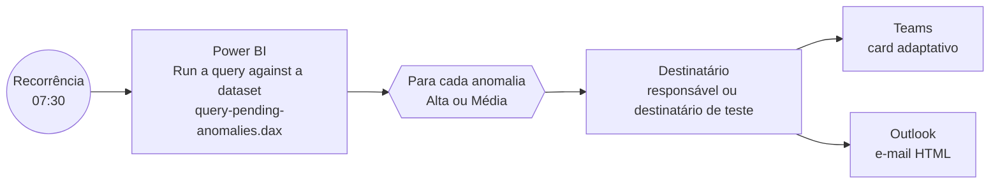

# Fluxo "Alerta de anomalia de perda" (Power Automate)

Fecha o ciclo **detectar → priorizar → alertar → orientar a ação**: o pipeline do Fabric detecta e explica; este fluxo leva cada anomalia ao responsável certo, com a hipótese e a ação recomendada, sem esperar o fechamento do mês.

| Arquivo | Conteúdo |
|---|---|
| [`flow-definition.json`](flow-definition.json) | Definição de referência do fluxo (Workflow Definition Language): gatilho, ações, conexões e parâmetros. Os três campos `<conteúdo de ...>` recebem os arquivos abaixo |
| [`query-pending-anomalies.dax`](query-pending-anomalies.dax) | Consulta DAX ao modelo: anomalias pendentes de alerta, prioridade Alta ou Média, detectadas nas últimas 24 h |
| [`adaptive-card.json`](adaptive-card.json) | Card do Teams (Adaptive Card 1.4) com as expressões do fluxo |
| [`email-template.html`](email-template.html) | Mesmo conteúdo em e-mail HTML |
| [`samples/`](samples) | Card preenchido com a anomalia de MG (semana de 02/04/2018), para abrir no [Adaptive Cards Designer](https://adaptivecards.io/designer/) |

## Por que consultar o modelo e não o lakehouse

O conector do Power BI é padrão (sem licença premium), respeita a segurança do modelo e usa os mesmos nomes de negócio do Copilot. A regra de "o que alertar" fica no dado (`Pendente de Alerta`, calculado pelo `nb_ai_detect_loss_anomalies`), não no fluxo: o fluxo só entrega.

**Idempotência.** Cada anomalia fica pendente em um único lote (o primeiro em que aparece, e só se for da última semana completa). A janela de 24 h em `Detectada em` impede reenvio se o pipeline não rodar num dia.

## Montar no seu ambiente

Pré-requisitos: modelo `Olist Prevenção de Perdas` publicado e atualizado pelo `pl_daily_loss_alerts`; conexões Power BI, Microsoft Teams e Office 365 Outlook com uma conta que tenha permissão de leitura (Build) no modelo.

1. **Create → Scheduled cloud flow**, todo dia às 07:30, fuso de Brasília.
2. Parâmetros do fluxo (ou variáveis de ambiente, se estiver numa solução): `WorkspaceId`, `DatasetId`, `UrlCentralAnomalias` (link da página Central de Anomalias) e `DestinatarioTeste` (seu e-mail na demonstração; vazio em produção).
3. **Power BI → Run a query against a dataset**: workspace e modelo pelos parâmetros, consulta = conteúdo de `query-pending-anomalies.dax`.
4. **Apply to each** sobre `First table rows`, concorrência 1.
5. **Compose** `Destinatario`: `if(empty(parameters('DestinatarioTeste')), items('Para_cada_anomalia')?['[EmailResponsavel]'], parameters('DestinatarioTeste'))`.
6. **Microsoft Teams → Post card in a chat or channel**: Flow bot, Chat with Flow bot, destinatário = `Destinatario`, card = conteúdo de `adaptive-card.json`.
7. **Office 365 Outlook → Send an email (V2)**: assunto e corpo como em `flow-definition.json` e `email-template.html`; importância Alta quando a prioridade for Alta.
8. Teste: rode o `pl_daily_loss_alerts` com `as_of_date = 2018-04-09` e, em seguida, **Test → Manually** no fluxo. Chegam dois alertas: MG (Alta) e Vendedor 88460e8e (Média).

O nome do loop (`Para_cada_anomalia`) é usado nas expressões; se mudar, troque também no card e no e-mail.

## Extensões naturais

- **Resposta do gestor**: trocar o card por *Post adaptive card and wait for a response* com botões "Confirmo a hipótese / Descarto" e gravar o retorno numa lista do SharePoint ou tabela do Dataverse, que volta ao lakehouse como rótulo para medir a qualidade das hipóteses.
- **Disparo por evento**: em vez da recorrência, o `pl_daily_loss_alerts` chama o fluxo no fim (atividade Web + gatilho HTTP, que exige licença premium) ou uma regra do Fabric Activator sobre a tabela.
