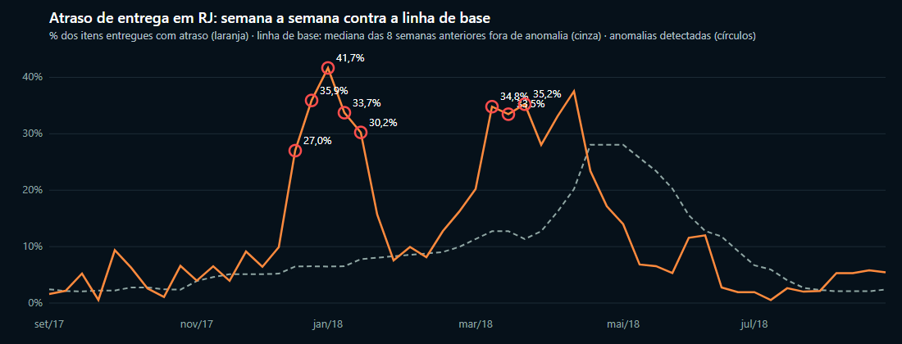
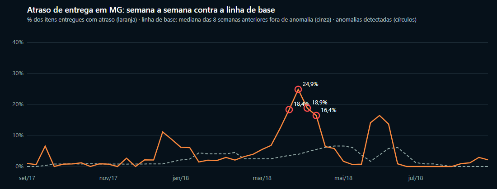

# Detecção de anomalias de perda

Como os três monitores do `nb_ai_detect_loss_anomalies` decidem o que vira alerta, o que o replay sobre o Olist encontrou e onde a regra é cega. A decisão de método está na [ADR 0001](decisions/0001-deteccao-robusta-explicavel.md).

## Parâmetros

| Monitor | Taxa | Segmento | Semana pela data | Volume mínimo | Piso de desvio | Fator mínimo | Impacto mínimo |
|---|---|---|---|---|---|---|---|
| M01 Receita perdida por categoria | receita de pedidos cancelados ou indisponíveis / receita bruta | Categoria | da compra | 30 itens | 1 p.p. | 2,0x | R$ 1.500 |
| M02 Atraso de entrega por UF do cliente | itens entregues após a data prevista / itens entregues | UF do cliente | da entrega | 30 itens | 3 p.p. | 1,5x | R$ 3.000 |
| M03 Atraso de entrega por vendedor | idem | Vendedor | da entrega | 15 itens | 3 p.p. | 1,5x | R$ 1.500 |

Comuns: linha de base de 8 semanas (mínimo 4 válidas, cada uma com 5 ou mais itens e fora de anomalia), escore robusto ≥ 3,5, prioridade Alta a partir de R$ 5 mil e Média a partir de R$ 2 mil de impacto.

**Por que a semana da entrega para atraso:** o atraso só é conhecido quando o item chega. Agrupar pela compra faria a detecção do fim de semana olhar para entregas que ainda não aconteceram.

## Replay sobre o histórico do Olist

A mesma regra rodada sobre os CSVs públicos (set/2016 a ago/2018), semana a semana, como se o pipeline estivesse em produção:

| | Total | Alta | Média | Baixa | Nova | Recorrente | Impacto estimado |
|---|---|---|---|---|---|---|---|
| M01 Receita perdida por categoria | 4 | 1 | 2 | 1 | 4 | 0 | R$ 16,7 mil |
| M02 Atraso por UF do cliente | 13 | 9 | 4 | 0 | 4 | 9 | R$ 106,3 mil |
| M03 Atraso por vendedor | 13 | 0 | 4 | 9 | 13 | 0 | R$ 25,1 mil |
| **Total** | **30** | **10** | **10** | **10** | **21** | **9** | **R$ 148,2 mil** |

As 10 de maior impacto:

| Semana | Monitor | Segmento | Taxa | Linha de base | Impacto |
|---|---|---|---|---|---|
| 13/08/2018 | M02 | SP | 14,5% | 1,1% | R$ 18.104 |
| 02/04/2018 | M02 | MG | 24,9% | 3,9% | R$ 11.249 |
| 08/01/2018 | M02 | RJ | 33,7% | 6,5% | R$ 10.358 |
| 09/07/2018 | M01 | Cool Stuff | 66,3% | 0,0% | R$ 9.619 |
| 01/01/2018 | M02 | RJ | 41,7% | 6,5% | R$ 9.519 |
| 25/12/2017 | M02 | RJ | 35,9% | 6,5% | R$ 9.029 |
| 18/12/2017 | M02 | RJ | 27,0% | 6,5% | R$ 8.480 |
| 19/03/2018 | M02 | RJ | 33,5% | 12,7% | R$ 7.822 |
| 26/03/2018 | M02 | RJ | 35,2% | 11,3% | R$ 7.219 |
| 15/01/2018 | M02 | RJ | 30,2% | 7,8% | R$ 6.763 |

O RJ concentra 43% do impacto em duas ondas de atraso (dez/2017 a jan/2018 e mar/2018). Em SP, a semana de 13/08/2018 é pequena em taxa (14,5%) mas enorme em volume (1.102 itens entregues), e 63% dos itens atrasados foram postados pelo vendedor depois do prazo limite: o sinal principal muda de transporte para vendedor.

## Onde a regra é cega (e por quê)

- **Ondas longas:** depois da semana 8 de uma onda não há linha de base válida e o segmento para de alertar; o nível novo vira o padrão. No RJ, as semanas de abril de 2018 (28% a 37%) não geram alerta porque a linha de base já tinha absorvido março. Decisão consciente: problema crônico vai para o painel e para o dono do processo, não para um alerta semanal repetido.
- **Pico logo após a onda:** em MG, a alta de maio/2018 (~16%) não alerta porque a linha de base ainda está em 14%. O período coincide com a greve dos caminhoneiros (fim de maio/2018), um caso que a regra deixa passar.
- **Sazonalidade:** Black Friday e Natal entram como anomalia. Para o Olist é útil (o atraso foi real); com sazonalidade forte, comparar com a mesma semana do ano anterior.
- **Segmentos pequenos:** vendedores com menos de 15 itens entregues por semana não são avaliados.

## Validação

- Os números acima vêm de um replay local da regra sobre os CSVs; os valores esperados de [`ai/test-questions.md`](../ai/test-questions.md) e do `nb_ai_evaluate_data_agent` usam a mesma base. Depois da primeira execução no Fabric, conferir com as consultas DAX de referência do banco de perguntas.
- Recalibrar quando o volume mudar: o piso de desvio e o impacto mínimo controlam quantos alertas chegam por semana; a meta é poucos e acionáveis.
